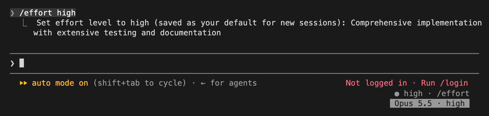

# model-badge

A compact badge in the right corner of Claude Code's footer showing the current model and effort, such as `Opus 5.5 · high`.



A [full-window view](docs/badge-full.png) shows the same session from the top.

- Model ids are shortened to a display name: `claude-opus-5-5` shows as `Opus 5.5`, a 1M-context model gains `1M`.
- The effort is the one the main loop actually sends, so a downgrade for the model shows.
- `/model` and `/effort` redraw it at once; any other model change (a settings change, a fallback) is picked up within a couple of seconds and flashed as a toast.
- As the footer narrows the badge drops the effort (below 60 columns), then hides (below 40).

## Install

```
/plugin marketplace add hmcdaniel03/claude-mods
/plugin install model-badge@hunters-mods
```

## Develop

```
claude plugin validate ./plugins/model-badge
claude plugin test ./plugins/model-badge
```

`tsconfig.json` extends `.claude-plugin/types/tsconfig.json`, which Claude Code writes into the folder when it loads the mod (for example with `claude --plugin-dir ./plugins/model-badge`); after that `tsc -p ./plugins/model-badge` type-checks it.
